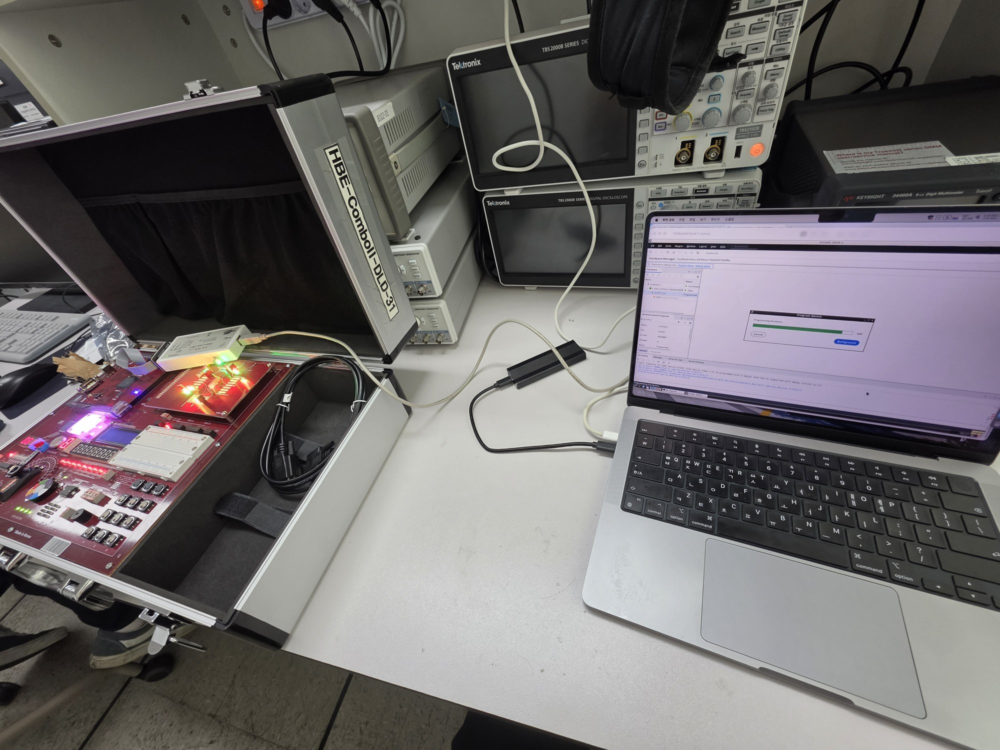
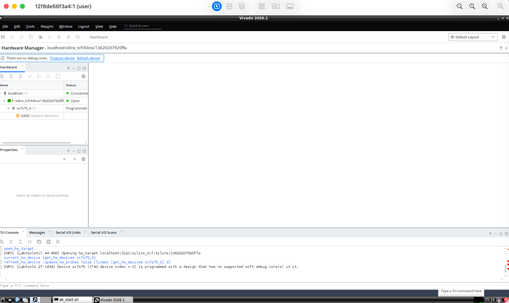
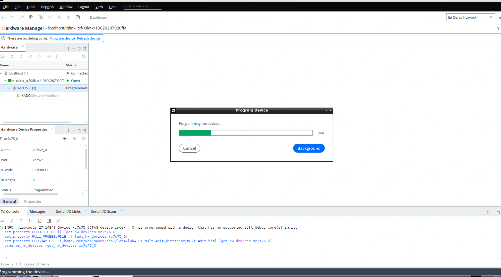
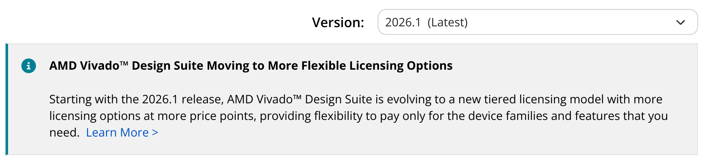
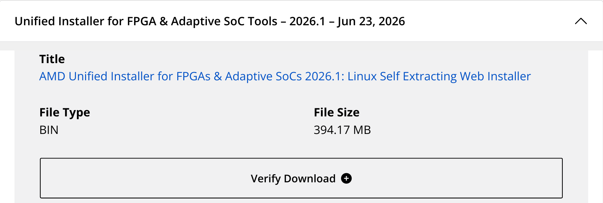
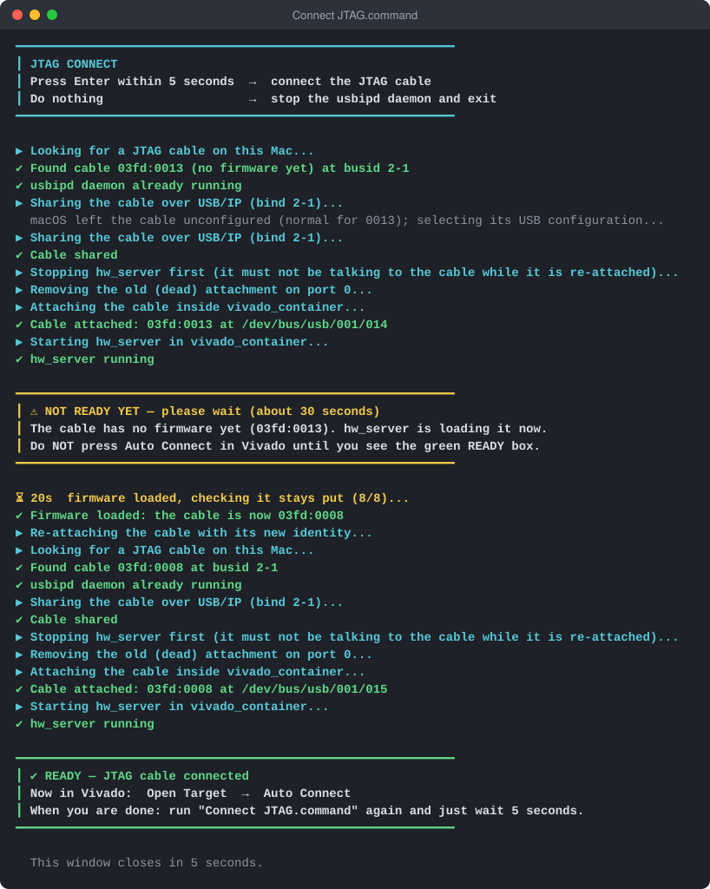
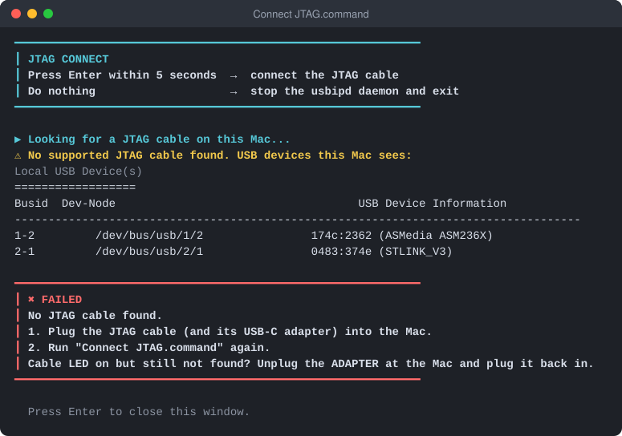

# vivado-on-silicon-mac-2026

Installs **Vivado 2026.1** or **2025.2** on Apple Silicon Macs. It runs Vivado inside a Rosetta-accelerated x86_64 Docker container, with the GUI exposed over VNC, and forwards a JTAG cable plugged into the Mac through to the container over USB/IP.

It is in no way associated with Xilinx or AMD. Vivado and Xilinx are trademarks of Xilinx, Inc. / AMD.

| Launching | Welcome screen | Synthesis → implementation → bitstream |
|:---:|:---:|:---:|
|  |  |  |

Running on an Apple Silicon Mac, seen through Screen Sharing. The third shot is the one that matters: `synth_1` and `impl_1` both complete and a bitstream written, for a Spartan-7 `xc7s75fgga484-1` — so the full flow really does run here, not just the GUI.

| The bench | Hardware Manager sees the FPGA | Programming over JTAG |
|:---:|:---:|:---:|
|  |  |  |

And it reaches real hardware: a Xilinx Platform Cable USB II plugged into the Mac, forwarded into the container over USB/IP, with Vivado's Hardware Manager detecting the Spartan-7 and programming it.

## Table of contents

- [How this works](#how-this-works)
- [Quick start](#quick-start)
- [Prerequisites](#prerequisites)
- [Installation](#installation)
- [Activating the free BASIC license](#activating-the-free-basic-license)
- [Everyday usage](#everyday-usage)
- [Connecting a JTAG cable](#connecting-a-jtag-cable)
- [Troubleshooting](#troubleshooting)
- [Adapting to a different Vivado version or device](#adapting-to-a-different-vivado-version-or-device)
- [Files overview](#files-overview)
- [License, copyright and trademark information](#license-copyright-and-trademark-information)
- [References](#references)

## How this works

Three things stand between an Apple Silicon Mac and a working FPGA setup. Most of this project is about solving them.

### Vivado has no macOS build

AMD ships Vivado for Windows and x86_64 Linux only, and Apple Silicon is neither. So Vivado runs here inside an x86_64 Ubuntu container, translated by Rosetta 2 through Apple's Virtualization framework, with its GUI exposed over VNC and opened in macOS's built-in Screen Sharing app.

The whole installation lives inside this repo's folder, which is bind-mounted into the container as `/home/user`. Nothing is installed into macOS itself, and deleting the folder removes everything. That also means anything you want to keep — projects, sources, constraint files — belongs inside this folder, where the container can reach it.

### The cable is plugged into the Mac, not the container

Apple's Virtualization framework has no USB passthrough, so a JTAG cable attached to the Mac is simply invisible to the container. The common workaround is to run a daemon on macOS that speaks the JTAG protocol itself and relays it over the network — which means that daemon has to support your particular cable. In practice that narrows you to FT2232C-based cables; anything else has no route in at all.

This project takes a different route. It forwards the **raw USB device** over USB/IP and never interprets JTAG on the Mac:

```
cable → macOS → usbipd (USB/IP server on the Mac, TCP 3240)
              → Docker Desktop VM kernel's vhci_hcd
              → /dev/bus/usb/… → container → Xilinx hw_server
```

The component that has to understand your cable is then Xilinx's own `hw_server` inside the container, exactly as on a real Linux machine — so cable support is AMD's problem rather than an open-source reimplementation's. Plug the cable in, run `Connect JTAG.command`, and it appears inside the container; see [Connecting a JTAG cable](#connecting-a-jtag-cable) for what that involves per cable type.

### Licensing that survives a restart

Vivado 2026.1 won't open without a license (2025.2 needs none for its free devices), and the free BASIC one is node-locked to a machine Host ID derived from the container's MAC address. Containers started with `--rm` don't get a stable MAC by default, so `setup.sh` generates one randomly on first run and pins it. It is therefore stable across restarts, and unique to your install — a single hardcoded Host ID shared by everyone who cloned the repo would look like abuse to AMD's licensing backend.

Beyond this, the repo is deliberately just the Vivado environment: no example projects, no VS Code or Dev Container setup, no Verilog tooling.

## Quick start

Everything below is copy and paste. Open the **Terminal** app (Applications → Utilities → Terminal), paste each grey box, and press Enter. Every step is explained in more detail further down — come back here if something goes wrong.

### 1. Install the tools this needs (once per Mac)

Xcode Command Line Tools (a window pops up: click **Install**; if it says they're already installed, move on):

```bash
xcode-select --install
```

[Homebrew](https://brew.sh), skip this if `brew --version` already works:

```bash
/bin/bash -c "$(curl -fsSL https://raw.githubusercontent.com/Homebrew/install/HEAD/install.sh)"
```

This makes `brew` usable in the current window (the Homebrew installer prints how to make it permanent):

```bash
eval "$(/opt/homebrew/bin/brew shellenv)"
```

Docker Desktop and libusb:

```bash
brew install --cask docker && brew install libusb
```

```bash
open -a Docker
```

Accept Docker's terms in the window that opens. You don't need a Docker account; skip the sign-in. You also need a free AMD account: create one at [amd.com](https://www.amd.com) if you don't have one.

### 2. Get this repo

This puts it in `Documents/vivado-on-mac`. Keep it in a folder whose path has no spaces.

```bash
git clone https://github.com/tae2yi/vivado-on-mac.git ~/Documents/vivado-on-mac
```

### 3. Download the Vivado installer

Pick a version:

| | **2026.1** (recommended) | **2025.2** |
|---|---|---|
| License | free BASIC license, activated once a year (step 5) | none needed for the free devices (Spartan-7, Artix-7, Zynq-7000, …) |
| Tested here | install, synthesis to bitstream, JTAG programming on a real board | JTAG programming on a real board (with 2025.2's `hw_server`); a full Vivado install not yet tried |

1. Open AMD's [Adaptive SoCs & FPGA Design Tools Downloads - 2026.1](https://www.amd.com/en/support/downloads/adaptive-socs-and-fpgas/development-tools/2026-1.html) page. If the link has moved, search Google for `Adaptive SoCs & FPGA Design Tools Downloads - 2026.1`. Set **Version** to the version you picked.

   

2. Under **AMD Unified Installer**, expand **Unified Installer for FPGA & Adaptive SoC Tools – 2026.1** (or `– 2025.2`; not an `Update` entry) and click **Linux Self Extracting Web Installer** — the `BIN` file of a few hundred MB. Skip the Windows `EXE` above it and the `SFD` (TAR/GZIP, about 98 GB) below it.

   

3. AMD asks you to sign in and fill in a short export-compliance form before the download starts. The file lands in Downloads, named like `FPGAs_AdaptiveSoCs_Unified_SDI_2026.1_..._Lin64.bin`.

Move it into the repo folder:

```bash
mv ~/Downloads/FPGAs_AdaptiveSoCs_Unified_SDI_*_Lin64.bin ~/Documents/vivado-on-mac/
```

### 4. Run the installer

```bash
cd ~/Documents/vivado-on-mac && caffeinate -dim zsh ./scripts/setup.sh
```

It takes 1–2 hours, mostly downloading; `caffeinate` keeps the Mac awake meanwhile. The script works through 7 numbered stages and tells you what each one is doing. Only the lines starting with a purple **➜** need you:

| It asks | You do |
|---|---|
| `Continue? [Y/n]` | press Enter |
| `Found FPGAs_…_Lin64.bin` → `Use this file? [Y/n]` | press Enter (it also tells you which Vivado version it found) |
| screen resolution | press Enter for 1920x1080 |
| a numbered list of device families | type the number of your board's chip only, e.g. `Spartan-7 FPGAs`, press Enter, then Enter again to confirm |
| `➜ AMD LOGIN` | type your AMD e-mail and password (the password doesn't show while you type) |

It ends with a green **✔ VIVADO … IS INSTALLED** box that says what to do next. If it stops with a red **✖ FAILED** box instead, the box says why and what to try.

### 5. Activate the free BASIC license (2026.1 only)

Vivado 2026.1 refuses to open without this, so don't skip it. On 2025.2, skip to step 6.

1. Start Vivado (step 6). Since no license exists yet, the **Vivado License Manager** pops up with an error instead of the main window — that's expected.
2. In the License Manager, go to **Obtain License → Get My Full or Purchased Certificate-Based License**, then click **Connect Now**. This opens a real browser to AMD's licensing page — log in with your AMD account.
3. AMD's site generates a free, node-locked BASIC license for this install, identified by its **Host ID**. You don't need to do anything with the Host ID yourself — `setup.sh` generated one for your install and pins it, so it stays the same every time you restart the container.
4. AMD emails you the generated `.lic` file. Install it with **Load License → Copy License…**, or just drop it into the `.Xilinx` folder in the repo — that folder is the container's home directory, so Finder works fine for this:

   ```bash
   open ~/Documents/vivado-on-mac/.Xilinx
   ```

5. Back in the License Manager, click **View License Status** and confirm it shows tier `BASIC` with the Host ID matching. It's valid for 12 months, after which you repeat this to renew.
6. Close the License Manager and start Vivado again — it should now open normally.

More detail and what to do if `Connect Now` doesn't respond: [Activating the free BASIC license](#activating-the-free-basic-license).

### 6. Start Vivado

Double-click **`Start Vivado.command`** in the repo folder, or:

```bash
cd ~/Documents/vivado-on-mac && ./scripts/start_container.sh
```

Vivado's desktop opens in Screen Sharing. Keep the Terminal window open while you work.

### 7. Connect a JTAG cable (optional)

Plug the cable in, double-click **`Connect JTAG.command`** and press Enter within 5 seconds. Wait for its green **READY** box, then click **Open Target → Auto Connect** in Vivado. See [Connecting a JTAG cable](#connecting-a-jtag-cable).

If anything above fails, jump to [Troubleshooting](#troubleshooting) or the detailed section for that step.

## Prerequisites

- An Apple Silicon Mac
- [Docker Desktop](https://www.docker.com/products/docker-desktop/), the "Apple Chip" build
- Rosetta (the installer prompts you to install it if it's missing)
- Xcode Command Line Tools, for the `swift` compiler — `setup.sh` builds the USB/IP server used for JTAG forwarding from source. Install with `xcode-select --install` if `swift --version` fails.
- [Homebrew](https://brew.sh)'s `libusb` (`brew install libusb`), which `jtag_connect.sh` uses to prepare a Xilinx Platform Cable USB II for forwarding
- A free AMD account — needed to download installer packages, and on 2026.1 to activate the free BASIC license
- The Vivado **Web Installer** file, downloaded yourself from AMD's site — a single `.bin` file, *not* the multi-GB full offline installer. Put it inside this repo's folder once downloaded. [Quick start](#quick-start) step 3 shows where it is on the download page.

## Installation

[Quick start](#quick-start) steps 1–4 are the whole installation; this is what `setup.sh` does in each of its stages, for when something goes wrong.

1. **Checking this Mac** — refuses to run as root, from a folder whose path contains a space, or over an existing install (the `Xilinx` folder); needs an internet connection. Then asks you to agree to AMD's EULAs and Apple's Rosetta license.
2. **Rosetta** — installed if missing.
3. **Vivado installer file** — uses the one `.bin` file in the repo folder if there is exactly one, otherwise asks you to drag it into the window, and offers to move it into the repo folder if it's elsewhere (the container only sees that folder). It reads the Vivado version from the file's own header, so a renamed file still works, and stops on anything but 2025.2 or 2026.1. The path and version go into `scripts/install_bin` and `scripts/vivado_version`.
4. **JTAG cable forwarding tools** — runs `setup_usbipd.sh`.
5. **Docker** — starts Docker Desktop, turns on Rosetta and raises swap in its settings (Docker restarts for this), then builds the `x64-linux` image.
6. **Container settings** — VNC resolution, the desktop autostart entry, and the container's pinned MAC address.
7. **Installing Vivado** — inside the container, `install_vivado.sh` goes through four steps:
   - **A. Choose what to install.** A numbered list of every device family and tool the installer offers. **Nothing is preselected** — type the numbers of only what you need, separated by spaces, and confirm. Vivado itself and Vitis HLS are always installed, because AMD's installer bundles them and offers no way to turn them off. Each extra family adds disk space, so choose only the chip on your board. Your choice is written to `scripts/install_configs/<version>.selected.txt` (e.g. `202610.selected.txt`, gitignored), generated from that version's catalog (`202520.txt` or `202610.txt`).
   - **B. Unpack the installer.**
   - **C. Log into your AMD account.** This only lets the installer download the selected packages — it's separate from license activation.
   - **D. Download and install**, ending in a green box with the next steps for your version.

If the installer rejects the catalog, you may see:
```
ERROR - The value specified for Edition (...) is invalid. Valid edition names are "...".
```
The error message tells you the correct name directly — edit `scripts/install_configs/<version>.txt` and rerun `setup.sh`.

To start over, run `zsh ./scripts/cleanup.sh`. It asks first, and copies any license file from `.Xilinx` to `saved-licenses/` before deleting the install.

## Activating the free BASIC license

Vivado 2026.1 requires activating a free, node-locked, annually-renewed **BASIC** license (2025.2 doesn't, for its free devices) — older `WebPACK`-style "no license file needed at all" licensing doesn't apply here. Do this inside the VNC session, after installation finishes:

**1. Open the License Manager.** Launching Vivado without a valid license opens it by itself. You can also reach it directly from the Start Menu under **Other → Manage Licenses 2026.1**, which is the easier route once Vivado is working normally.


**2. Find your Host ID.** Under **View System Information → View Host Information**, the **Network Interface Card (NIC) ID** is the value AMD locks the license to. It's your container's pinned MAC address with the colons removed, so it should match `scripts/mac_address` on the Mac — `setup.sh` generates that randomly on first run, which is what keeps it both unique to your install and stable across restarts. The same value comes from `lmutil` inside the container:

```
.../Xilinx/<version>/Vivado/bin/unwrapped/lnx64.o/lmutil lmhostid
```


**3. Request the license.** Go to **Obtain License → Get My Full or Purchased Certificate-Based License** and click **Connect Now**.


That opens a real browser inside the container, on AMD's product licensing site. Log in with the same AMD account, then fill in the **Name and Address Verification** form — US export regulations require it, and the form rejects PO boxes and non-Roman characters. Generate a node-locked BASIC license against the Host ID from the previous step, and AMD emails you the resulting `.lic` file.


**4. Install the `.lic` file.** Either use **Load License → Copy License…** and pick the file, or put it into the `.Xilinx` folder yourself. That folder sits in this repo's directory and is the container's `$HOME/.Xilinx`, so you can drop the file in from Finder on the macOS side without going through the VNC session at all. Vivado picks up any valid node-locked `*.lic` it finds there.

| Load License | …or place it in `.Xilinx` from macOS |
|:---:|:---:|
|  |  |

**5. Confirm.** **View License Status** should now show tier `BASIC` against your Host ID. It's valid for 12 months; repeat this process to renew.

**If "Connect Now" does nothing:** check that a real Firefox is installed (`firefox --version` inside the container). This repo's Dockerfile already fixes a common Ubuntu/Docker Firefox problem (see [Troubleshooting](#troubleshooting)) — this only matters if you rebuilt the image some other way.

## Everyday usage

Once installed, day to day you only need to double-click **`Start Vivado.command`** in the repo's root folder — it's a Finder shortcut that opens a Terminal window and runs `./scripts/start_container.sh` for you. If you'd rather run it yourself from a terminal, that's the same command:
```
./scripts/start_container.sh
```
Either way, this starts the container and opens Screen Sharing to the VNC session. To stop, press `Ctrl+C` in the Terminal window it opened (or log out inside the VNC session).

To use a JTAG cable, connect it separately with `Connect JTAG.command` — see below.

## Connecting a JTAG cable

[How this works](#the-cable-is-plugged-into-the-mac-not-the-container) sketches the path a cable takes to reach the container. One detail from it is worth restating, because it explains most of what follows: the container doesn't connect to the USB/IP server itself — the VM's kernel does. `usbip attach` opens a TCP connection and hands the socket to the kernel's `vhci_hcd` driver, which registers a virtual USB device; the container simply sees the resulting device node.

### Usage

1. Start the container with `Start Vivado.command`.
2. Plug in the cable.
3. Double-click **`Connect JTAG.command`** and **press Enter within 5 seconds**.
4. **Wait for the green `✔ READY` box.** With a Xilinx Platform Cable that was just plugged in this takes about 40 seconds, because its firmware has to be loaded first; the script does that by itself and shows a yellow `⚠ NOT READY YET` box meanwhile.
5. Only then, in Vivado's Hardware Manager, click **Open Target → Auto Connect**.



That is the output of a real run with a freshly plugged-in Platform Cable USB II, 41 seconds from Enter to READY. One run is enough. Don't click Auto Connect before the READY box: that is what produces Vivado's misleading `Cannot support out-of-date hw_server` error, see [Troubleshooting](#troubleshooting).

Doing nothing for those 5 seconds instead shuts the USB/IP daemon down and exits. That's the safe default if you hit the shortcut by accident, and it's also how you tidy up when you're finished — the daemon otherwise keeps running until you stop it or reboot.

You can connect the cable while the container is already running; there's no need to restart it. No password is asked for: `usbipd` runs as your own user, since macOS lets it open a USB device no driver has claimed.

Running it again when the cable is already attached does nothing (`✔ ALREADY CONNECTED`), so it's safe to double-click whenever you're unsure.

Every line the script prints starts with a symbol that says what kind of line it is:

| Symbol | Colour | Meaning |
|:---:|---|---|
| `▶` | cyan | a step is in progress |
| `✔` | green | that step is done |
| `⚠` | yellow | heads-up; in a box, "wait, not ready yet" |
| `✖` | red | it failed; the box says what to do next |

`setup.sh` and the other install scripts use the same symbols, plus a purple `➜` for lines that need you to type or do something.

The window closes on its own 5 seconds after a successful connection. If something fails, it stays open with the reason and the next thing to try until you press Enter, so an error can't disappear along with the window. This is what a failure looks like, here with no cable plugged in:



### Supported cables

The script identifies the cable by vendor ID, so it works regardless of which port you use. These are the vendor IDs Vivado's own cable drivers recognize:

| Vendor ID | Cables | Handling after attach |
|---|---|---|
| `0x03fd` | Xilinx Platform Cable USB / USB II | `hw_server` loads its firmware, see below |
| `0x0403` | FTDI-based (Xilinx and Digilent) | Kernel's `ftdi_sio` driver is unbound automatically |
| `0x1443` | Digilent | Permissions only |

### Xilinx Platform Cable USB II: the firmware load

Every time it's plugged in, this cable starts out without firmware, as `0x03fd:0x0013`. Xilinx's `hw_server` loads the firmware into the cable's RAM as soon as it sees the cable, exactly as it does on Windows or Linux. Nothing is written permanently; unplugging the cable clears it.

Loading it makes the cable re-enumerate as `0x03fd:0x0008` — a different USB device as far as the system is concerned, which leaves the USB/IP attachment just made pointing at a device that no longer exists. So connecting this cable really takes four steps, and `Connect JTAG.command` does all of them in one run:

1. attach the firmware-less `0013` cable to the container;
2. start `hw_server` there and ask it for its JTAG targets, which makes it load the firmware. The asking matters: `hw_server` started on its own never scans for cables and leaves this one at `0013` indefinitely, so the script connects `xsdb` to it once as a client;
3. wait for the cable to come back as `0008` and **stay** there, then stop `hw_server`, drop the dead `0013` attachment and attach the `0008` cable;
4. start `hw_server` again, so Vivado's Auto Connect joins a server that already sees the cable.

Step 3 waits for `0008` to hold for 8 seconds rather than acting on the first sighting: during the load the cable re-enumerates twice, a few seconds apart, and shows up as `0008` in between.

Two more details the script takes care of: macOS leaves the firmware-less cable unconfigured, since no macOS driver matches it, so the script selects its USB configuration before sharing it; and `usbipd-mac` needs fixes before this cable can program an FPGA through it, which `setup_usbipd.sh` applies from `scripts/usbipd-mac.patch`.

Don't unplug the cable, or run anything that restarts `usbipd`, while `hw_server` is talking to it. The cable's firmware is left mid-transfer and stops answering until it's unplugged. `jtag_connect.sh` stops `hw_server` first whenever it has to restart `usbipd` or drop an old attachment.

#### Why not just click Auto Connect and let Vivado load the firmware?

Because of the stale attachment. If Vivado's own Auto Connect starts while the cable is still `0013`, the `hw_server` it launches loads the firmware and is then left holding a dead device, and the connect hangs for 30–40 seconds. What Vivado reports next depends on what happens to that `hw_server`, checked by running the same Tcl commands Auto Connect uses (`connect_hw_server`, `open_hw_target`) in batch mode:

| Cable when the connect starts | `hw_server` during the connect | Result |
|---|---|---|
| `0013` | stopped, to re-attach the cable | hangs 29 s, then **`[Xicom 50-198] Cannot support out-of-date hw_server`** and `[Labtools 27-3461]` |
| `0013` | left alone | hangs 41 s, then `[Labtoolstcl 44-494]` (no target) |
| `0008` | killed at various moments, frozen, restarted behind Vivado's back | `[Labtools 27-3733]`, `27-2220`, `44-513` or success; never `50-198` |

The two `0013` rows were each run once (they need the cable replugged), the `0008` row about 25 times. So "out-of-date hw_server" has nothing to do with versions: it means Auto Connect was started on a cable whose firmware wasn't loaded yet. Wait for the READY box and click Auto Connect again.

### What the script does that udev normally would

The container runs no udev daemon, so Vivado's `52-xilinx-*.rules` never fire. Two things they would normally handle are done by `jtag_connect.sh` instead:

- **Device permissions.** `hw_server` runs as uid 1000, not root, and a freshly attached device node is root-owned. Without a `chmod`, `lsusb` shows the cable while `hw_server` silently can't open it — a confusing failure worth knowing about if you ever connect a device by hand.
- **Unbinding `ftdi_sio`** for FTDI cables, which the kernel otherwise claims as a serial port.

> **Status:** verified against real hardware with a Xilinx Platform Cable USB II and a Spartan-7 `xc7s75fgga484-1` board (HBE-Combo II-DLD): the firmware load, `hw_server` detecting the cable and reading the FPGA's IDCODE, and programming a bitstream (`End of startup status: HIGH`) — see the screenshots at the top — and `Connect JTAG.command` taking a freshly plugged-in cable to READY in a single run. FTDI and Digilent cables haven't been tried on hardware yet. 2025.2's `hw_server` passed the same test on the same board: it loaded the Platform Cable's firmware, `Connect JTAG.command` reached READY in 35 seconds, and it programmed a bitstream (DONE pin high, end of startup reached) in about 13 seconds. That ran with AMD's standalone Hardware Server 2025.2 rather than a full Vivado 2025.2 install. Reports welcome.

## Troubleshooting

| Symptom | Cause / fix |
|---|---|
| `no such file or directory: /Users/you/Library/Application` (or similar truncated path) | Your repo path has a space in it (e.g. `~/Library/Application Support/...`). Some scripts use `eval` internally, which re-splits on spaces. Simplest fix: clone the repo somewhere without spaces, like `~/Documents/...`. |
| Vivado License Manager: "no valid license was not found" | Expected on first launch — follow [Activating the free BASIC license](#activating-the-free-basic-license). |
| `Connect Now` in the License Manager does nothing | The container's Firefox isn't working. Ubuntu 22.04's `firefox` apt package is a snap stub that can't run in Docker; this repo's Dockerfile installs a real Firefox from Mozilla's own apt repo instead — make sure you're using the current `scripts/Dockerfile` and rebuilt the image (`./scripts/gen_image.sh`). |
| Vivado crashes immediately with `realloc(): invalid pointer` | Missing `LD_PRELOAD`, which the container needs set or Vivado dies on startup. Exporting it in a parent shell isn't enough, since it doesn't survive `sudo`; instead `install_vivado.sh` bakes it into the `Exec=` line of every generated `.desktop` launcher right after installation. So this normally only appears if you launch `bin/vivado` some other way — prefix that command with the same `LD_PRELOAD` (copy it from `scripts/de_start.sh`). |
| `ERROR - The value specified for Edition (...) is invalid` during install | The catalog names in `install_configs/202610.txt` (or `202520.txt`) don't match what the installer expects. The error itself states the correct name — edit the file and rerun. |
| Batch install complains about an invalid `Modules=` entry name | Same as above, but for a device/module name instead of the edition. Find the correct name in the installer's error and fix that specific entry (don't remove or reorder others). |
| `Connect JTAG.command`: "usbipd is missing" | `setup.sh` hasn't been run, or its usbipd-mac build step failed. Run `zsh ./scripts/setup_usbipd.sh`, which does just that step. |
| `Connect JTAG.command`: "usbipd was built without this repo's fixes" | Your install predates `scripts/usbipd-mac.patch`. Run `zsh ./scripts/setup_usbipd.sh` once; it applies the fixes and rebuilds. |
| `setup_usbipd.sh`: "The libusb library is missing" | Run `brew install libusb`, then run it again. |
| `Connect JTAG.command`: "No JTAG cable found" | The cable isn't attached, or its vendor ID isn't one of the three in [Supported cables](#supported-cables). The message lists every USB device macOS can see, so check whether yours appears at all. |
| Vivado: `[Xicom 50-198] Cannot support out-of-date hw_server` / `[Labtools 27-3461] Cannot support an older version of hw_server` on Auto Connect | Not a version problem. Auto Connect was clicked while the Platform Cable's firmware wasn't loaded yet (`0x0013`). Dismiss the error, wait for the green READY box from `Connect JTAG.command` (run it again if its window is gone), then click Auto Connect again. Details: [the firmware load](#xilinx-platform-cable-usb-ii-the-firmware-load). |
| `Connect JTAG.command`: "The cable did not finish loading its firmware" | The cable never settled as `0x0008` within 90 seconds. Run it again; if that fails too, unplug the USB-C adapter from the Mac, plug it back in and run it once more. |
| `Connect JTAG.command`: bind refused, naming a driver that owns the device | macOS has claimed the device and won't release it. This affects HID, mass storage, audio and camera class devices; releasing them needs a DriverKit entitlement Apple declined to grant usbipd-mac. Vendor-specific devices and FTDI/CP210x serial adapters are unaffected, so a JTAG cable normally isn't hit by this. |
| Cable shows up in `lsusb` inside the container, but Vivado's Hardware Manager doesn't see it | Compare what each side sees. If the Mac lists the cable as `03fd:0008` but the container still shows `03fd:0013`, the container is holding a dead attachment from before the firmware load: run `Connect JTAG.command` again and wait for READY — see [the firmware load](#xilinx-platform-cable-usb-ii-the-firmware-load). Otherwise restart `hw_server` inside the container; it scans for cables when it starts. |
| The cable disappears from the Mac entirely (not even in the "USB devices this Mac sees" list), though its status LED is on | macOS's accessory security locked the USB-C port after the cable was unplugged behind an adapter that stayed plugged in; it doesn't prompt again, because as far as it knows the adapter never left. Unplug the **adapter** from the Mac and plug it back in. |
| Programming or scanning fails with timeouts, and the cable stops answering | The cable's firmware was interrupted mid-transfer, e.g. by unplugging it or restarting `usbipd` while `hw_server` was using it. Unplug the adapter from the Mac, plug it back in, and connect again from the start. |
| Double-clicking `Start Vivado.command` does nothing, or macOS warns it's from an unidentified developer | Gatekeeper blocking a downloaded script the first time. Right-click the file → **Open** → confirm, or run `chmod +x "Start Vivado.command"` once from a terminal. A `git clone` normally doesn't trigger this; downloading the repo as a ZIP is more likely to. |

## Adapting to a different Vivado version or device

- Supported versions are listed in `supported_versions` at the top of `scripts/setup.sh`. `setup.sh` reads the version from the installer's own header (falling back to its file name), and `install_vivado.sh` picks the catalog `scripts/install_configs/<yyyyv0>.txt` for it, e.g. `202610.txt` for 2026.1.
- To add a version, generate its catalog from that version's installer instead of writing one by hand: unpack the `.bin` with `--noexec --target installer` inside the container, run `installer/xsetup -b ConfigGen`, choose Vivado and the edition, and copy the resulting `~/.Xilinx/install_config.txt` to `install_configs/<yyyyv0>.txt` with `Destination=/home/user/Xilinx` and every `Modules=` flag set to `:0`. Then add the version to `supported_versions`.
- A catalog's `Modules=` line is a full, ordered list of every entry. `scripts/select_modules.sh` shows the family and tool names (the entries that start with a capital letter; lowercase entries such as `xcv80` are individual devices and stay off) as a menu, and writes your choice to `<yyyyv0>.selected.txt`. You don't edit flags by hand. If the installer rejects a name, take the correct one from its error message and fix only that entry. Don't remove or reorder entries.
- Expect the catalog to be renamed between releases rather than merely extended. 2026.1 changed the `Edition` name to `Vivado Design Suite` (2025.2 still uses `Vivado ML Standard`), so a catalog from one version won't carry over to another.

## Files overview

Supporting pieces you rarely touch directly: `header.sh` (shared shell functions), `configure_docker.sh` (Docker settings), `gen_image.sh` (image build), `linux_start.sh` (container entry point), `cleanup.sh` (removes Vivado and dotfiles, keeping a copy of the license), `install_bin` and `vivado_version` (the installer's path and version, written by `setup.sh`), `vnc_resolution`, `vncpasswd`.

The parts that carry this project's own behaviour:

- `Start Vivado.command`, `Connect JTAG.command` — double-clickable Finder shortcuts for `start_container.sh` and `jtag_connect.sh`
- `scripts/jtag_connect.sh` — finds the cable by vendor ID, binds it on the Mac, replaces any stale attachment of it, attaches it inside the container, and applies the fixups udev would normally handle. For a Platform Cable it also starts `hw_server` and prompts it to load the firmware, waits for the cable to re-enumerate, re-attaches it and leaves `hw_server` running for Vivado to join
- `scripts/start_container.sh` — no longer runs `xvcd`; the container now gets `--privileged` and `/dev/bus/usb` so it can see a USB/IP-attached cable, including one attached after it started
- `scripts/de_start.sh` — `hw_server` searches the local USB bus instead of connecting to an XVC server on the Mac
- `scripts/setup.sh` — the 7-stage installer: finds the installer file and reads its version, runs `setup_usbipd.sh`, configures Docker and builds the image, then runs `install_vivado.sh` in the container. Its output uses the same `▶ ✔ ⚠ ✖` symbols as `Connect JTAG.command`, plus `➜` for lines that need you
- `scripts/setup_usbipd.sh` — clones usbipd-mac into `mac-tools/` (gitignored), applies `usbipd-mac.patch` to it and builds it, and sets up the python environment with `libusb1` that `jtag_connect.sh` uses. Can be run on its own
- `scripts/usbipd-mac.patch` — fixes usbipd-mac needs before a Platform Cable can program an FPGA through it; the top of the file explains each one
- `scripts/Dockerfile` — installs `usbutils`, and builds the `usbip` client from the kernel source tree, pinned to the `v6.12` release that matches Docker Desktop's kernel. That build exists because Ubuntu has no standalone `usbip` package: it ships the binary only inside `linux-tools-<version>-generic`, pinned to a kernel version that Docker Desktop's LinuxKit kernel has no package for. Also carries a real Firefox from Mozilla's apt repo, the extra libraries Vivado's `installLibs.sh` expects, and an LSB-compatible loader symlink that `lmutil` needs
- `scripts/mac_address` — the container's pinned MAC, randomly generated on first run and gitignored; see [Licensing that survives a restart](#licensing-that-survives-a-restart)
- `scripts/select_modules.sh` — asks which device families and tools to install and writes the batch config the installer uses, so only what you choose (plus the bundled Vivado and Vitis HLS) is downloaded
- `install_configs/202610.txt`, `install_configs/202520.txt` — the 2026.1 and 2025.2 install catalogs (all entries off; `select_modules.sh` turns on your choices in a generated `<yyyyv0>.selected.txt`)

## License, copyright and trademark information

The repository's contents are licensed under the **Creative Commons Zero v1.0 Universal** license.

Running these scripts means you agree to Xilinx'/AMD's and third-party EULAs (obtainable by extracting the installer yourself) and to [Apple's software license agreement](https://www.apple.com/legal/sla/) for Rosetta 2.

This repository vendors no third-party code, apart from `scripts/usbipd-mac.patch`, a set of modifications to usbipd-mac that is covered by that project's MIT license. Two external components are fetched and built during setup, under their own licenses: [usbipd-mac](https://github.com/beriberikix/usbipd-mac) by Jonathan Beri (MIT), cloned into `mac-tools/` and patched by `setup_usbipd.sh`, and the USB/IP userspace utilities from the Linux kernel source tree (`tools/usb/usbip`, GPL v2), built into the Docker image.

Vivado and Xilinx are trademarks of Xilinx, Inc. Arm is a registered trademark of Arm Limited. Apple, Mac, macOS and Rosetta are trademarks of Apple Inc. Docker and the Docker logo are trademarks of Docker, Inc. Linux® is the registered trademark of Linus Torvalds.

## References

The Docker + Rosetta + VNC approach and the original scripts come from [ichi4096/vivado-on-silicon-mac](https://github.com/ichi4096/vivado-on-silicon-mac), which covers Vivado 2021.1–2024.1 and forwards JTAG with [xvcd](https://github.com/tmbinc/xvcd). This project updates that to 2026.1 and replaces the xvcd/XVC path with USB/IP.
