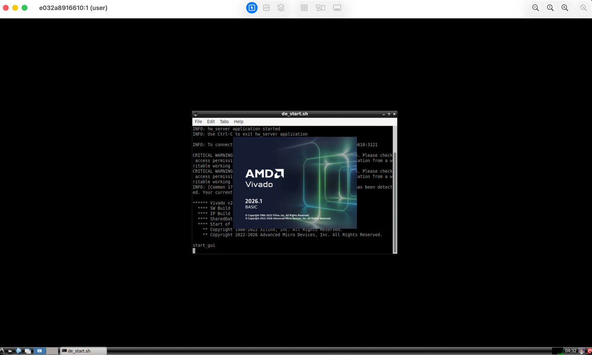
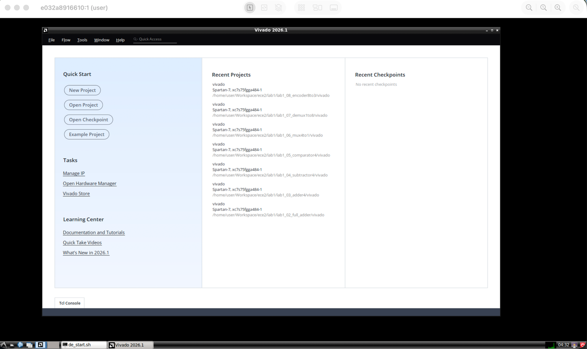
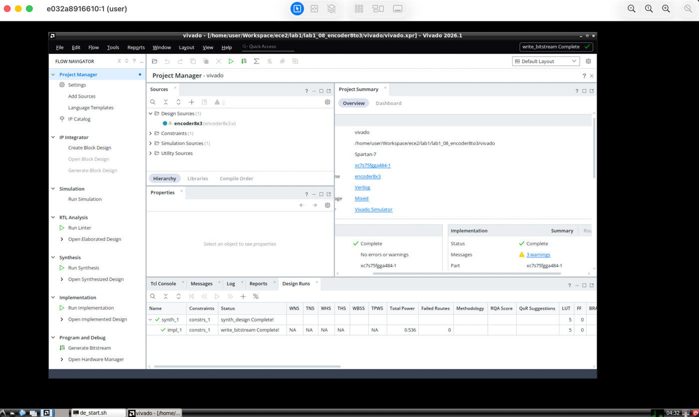
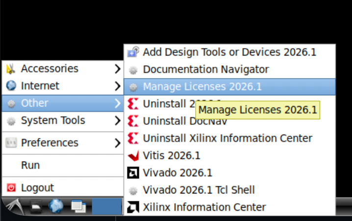
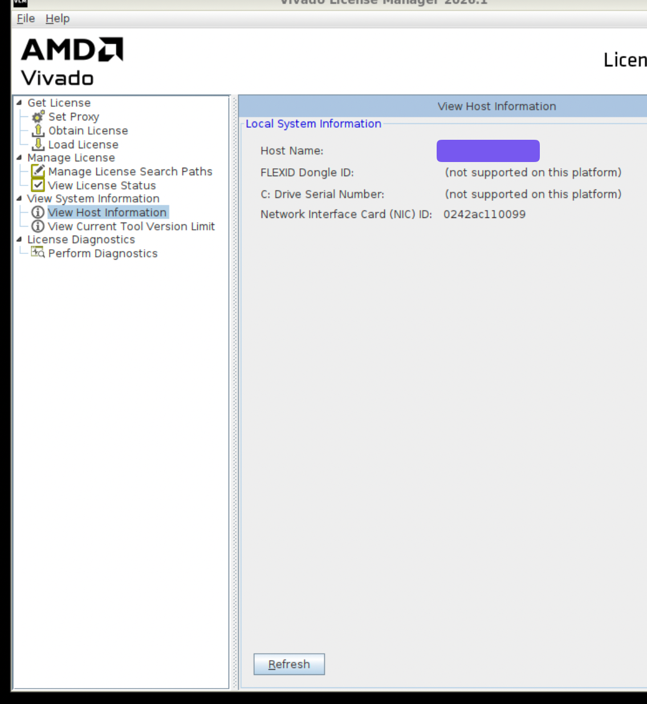
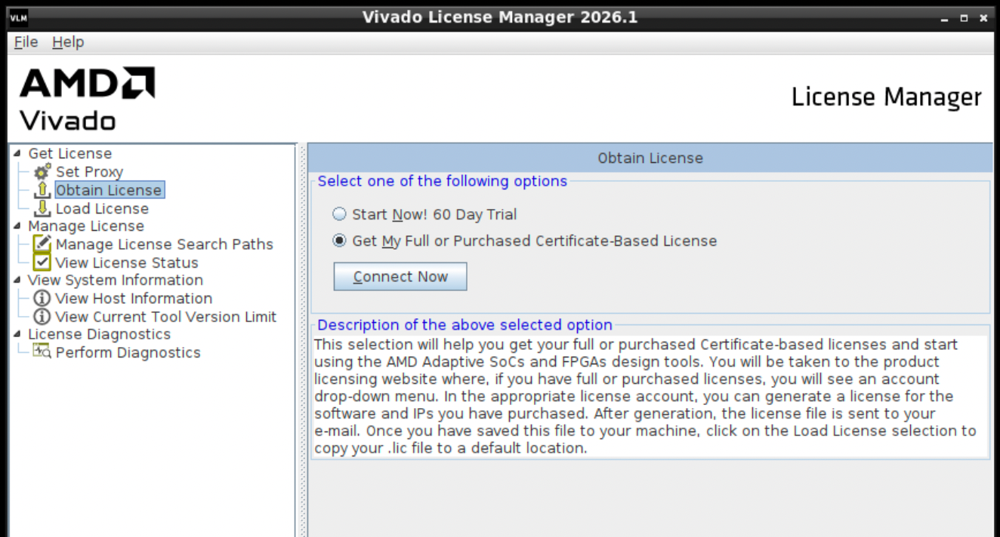
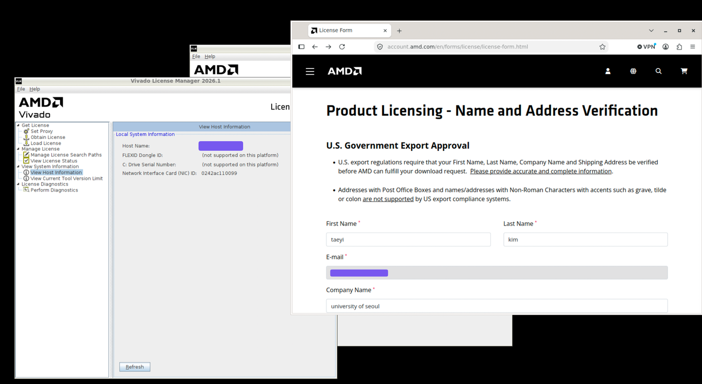
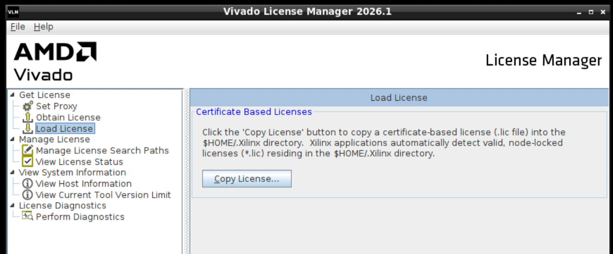
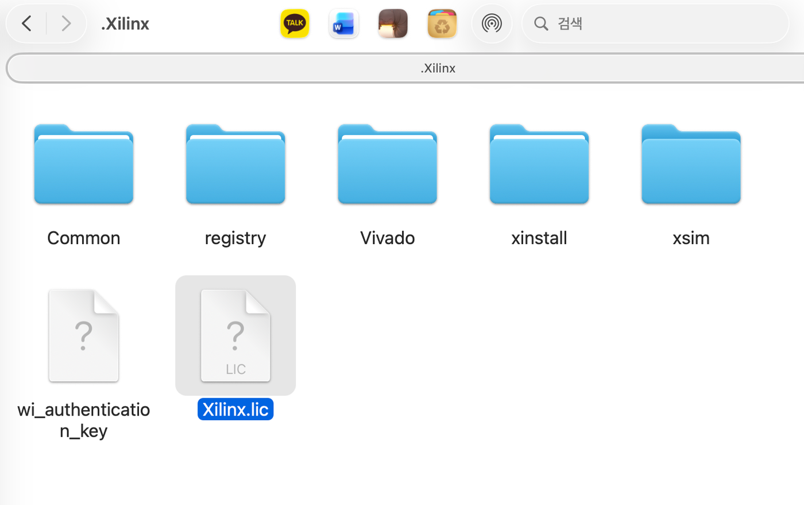

# vivado-on-silicon-mac-2026

Installs **Vivado 2026.1** on Apple Silicon Macs. It runs Vivado inside a Rosetta-accelerated x86_64 Docker container, with the GUI exposed over VNC, and forwards a JTAG cable plugged into the Mac through to the container over USB/IP.

It is in no way associated with Xilinx or AMD. Vivado and Xilinx are trademarks of Xilinx, Inc. / AMD.

| Launching | Welcome screen | Synthesis → implementation → bitstream |
|:---:|:---:|:---:|
|  |  |  |

Running on an Apple Silicon Mac, seen through Screen Sharing. The third shot is the one that matters: `synth_1` and `impl_1` both complete and a bitstream written, for a Spartan-7 `xc7s75fgga484-1` — so the full flow really does run here, not just the GUI.

## Table of contents

- [How this works](#how-this-works)
- [Quick start](#quick-start)
- [Prerequisites](#prerequisites)
- [Installation](#installation)
- [Activating the free BASIC license](#activating-the-free-basic-license)
- [Everyday usage](#everyday-usage)
- [Connecting a JTAG cable](#connecting-a-jtag-cable)
- [Troubleshooting](#troubleshooting)
- [Adapting to a different Vivado version or device](#adapting-to-a-different-vivado-version-or-device)
- [Files overview](#files-overview)
- [License, copyright and trademark information](#license-copyright-and-trademark-information)
- [References](#references)

## How this works

Three things stand between an Apple Silicon Mac and a working FPGA setup. Most of this project is about solving them.

### Vivado has no macOS build

AMD ships Vivado for Windows and x86_64 Linux only, and Apple Silicon is neither. So Vivado runs here inside an x86_64 Ubuntu container, translated by Rosetta 2 through Apple's Virtualization framework, with its GUI exposed over VNC and opened in macOS's built-in Screen Sharing app.

The whole installation lives inside this repo's folder, which is bind-mounted into the container as `/home/user`. Nothing is installed into macOS itself, and deleting the folder removes everything. That also means anything you want to keep — projects, sources, constraint files — belongs inside this folder, where the container can reach it.

### The cable is plugged into the Mac, not the container

Apple's Virtualization framework has no USB passthrough, so a JTAG cable attached to the Mac is simply invisible to the container. The common workaround is to run a daemon on macOS that speaks the JTAG protocol itself and relays it over the network — which means that daemon has to support your particular cable. In practice that narrows you to FT2232C-based cables; anything else has no route in at all.

This project takes a different route. It forwards the **raw USB device** over USB/IP and never interprets JTAG on the Mac:

```
cable → macOS → usbipd (USB/IP server on the Mac, TCP 3240)
              → Docker Desktop VM kernel's vhci_hcd
              → /dev/bus/usb/… → container → Xilinx hw_server
```

The component that has to understand your cable is then Xilinx's own `hw_server` inside the container, exactly as on a real Linux machine — so cable support is AMD's problem rather than an open-source reimplementation's. Plug the cable in, run `Connect JTAG.command`, and it appears inside the container; see [Connecting a JTAG cable](#connecting-a-jtag-cable) for what that involves per cable type.

### Licensing that survives a restart

Vivado 2026.1 won't open without a license, and the free BASIC one is node-locked to a machine Host ID derived from the container's MAC address. Containers started with `--rm` don't get a stable MAC by default, so `setup.sh` generates one randomly on first run and pins it. It is therefore stable across restarts, and unique to your install — a single hardcoded Host ID shared by everyone who cloned the repo would look like abuse to AMD's licensing backend.

Beyond this, the repo is deliberately just the Vivado environment: no example projects, no VS Code or Dev Container setup, no Verilog tooling.

## Quick start

For anyone who just wants the environment running with minimal reading. Every step is explained in more detail further down — come back here if something goes wrong.

1. **Install Docker Desktop** ("Apple Chip" build) and let it install Rosetta if it asks.
2. **Create a free AMD account** at amd.com, if you don't have one.
3. **Download the Vivado 2026.1 Web Installer** from AMD's site — look for a file named like `FPGAs_AdaptiveSoCs_Unified_SDI_2026.1_..._Lin64.bin`, roughly a few hundred MB. Don't download the multi-gigabyte full offline installer.
4. **Clone this repo somewhere with no spaces in the path**, e.g. `~/Documents/vivado-on-silicon-mac-2026` (not `~/Library/Application Support/...`).
5. Move the downloaded `.bin` file into the cloned folder.
6. Run:
   ```
   caffeinate -dim zsh ./scripts/setup.sh
   ```
   and follow the yellow prompts — drag in the `.bin` file when asked, then log into your AMD account when the container asks for it.
7. **Activate the free BASIC license** — Vivado 2026.1 refuses to open at all without this, so don't skip it:
   1. Launch Vivado (Desktop icon or Start Menu, inside the VNC session). Since no license exists yet, the **Vivado License Manager** pops up with an error instead of the main window — that's expected.
   2. In the License Manager, go to **Obtain License → Get My Full or Purchased Certificate-Based License**, then click **Connect Now**. This opens a real browser to AMD's licensing page — log in with the same AMD account from step 2.
   3. AMD's site generates a free, node-locked BASIC license for this specific machine, identified by its **Host ID**. You don't need to do anything with the Host ID yourself — `setup.sh` randomly generates one MAC address for your install on first run and pins it (`--mac-address` in `setup.sh`/`start_container.sh`), so it stays the same every time you restart the container, but is unique to your install rather than shared with everyone else using this repo.
   4. AMD emails you the generated `.lic` file. Install it with **Load License → Copy License…**, or just drop it into the `.Xilinx` folder in this repo — that folder is the container's home directory, so Finder works fine for this.
   5. Back in the License Manager, click **View License Status** and confirm it shows tier `BASIC` with the Host ID matching. That's it — it's valid for 12 months, after which you repeat this same process to renew.
   6. Close the License Manager and launch Vivado again — it should now open normally.

   More detail and what to do if `Connect Now` doesn't respond: [Activating the free BASIC license](#activating-the-free-basic-license).
8. From then on, just double-click **`Start Vivado.command`** in the repo folder (or run `./scripts/start_container.sh`) to open Vivado.
9. To use a JTAG cable, plug it in and double-click **`Connect JTAG.command`**, pressing Enter within 5 seconds. See [Connecting a JTAG cable](#connecting-a-jtag-cable).

If anything above fails, jump to [Troubleshooting](#troubleshooting) or the detailed section for that step.

## Prerequisites

- An Apple Silicon Mac
- [Docker Desktop](https://www.docker.com/products/docker-desktop/), the "Apple Chip" build
- Rosetta (the installer prompts you to install it if it's missing)
- Xcode Command Line Tools, for the `swift` compiler — `setup.sh` builds the USB/IP server used for JTAG forwarding from source. Install with `xcode-select --install` if `swift --version` fails.
- [Homebrew](https://brew.sh)'s `libusb` (`brew install libusb`), which `jtag_connect.sh` uses to prepare a Xilinx Platform Cable USB II for forwarding
- A free AMD account — needed both to download installer packages and to activate the free BASIC license
- The Vivado **Web Installer** file, downloaded yourself from AMD's site — a single `.bin` file, *not* the multi-GB full offline installer. Put it inside this repo's folder once downloaded.

## Installation

1. Clone this repo **to a path with no spaces** — see [Troubleshooting](#troubleshooting) for why this matters.
2. Put the Vivado web installer `.bin` file inside the cloned folder.
3. Run:
   ```
   caffeinate -dim zsh ./scripts/setup.sh
   ```
4. When asked to drag and drop the installation binary, drag in the `.bin` file itself.
5. The container builds, then prompts you to log into your AMD account. This step downloads the selected packages — it's separate from license activation, which happens later.
6. Batch installation proceeds using `scripts/install_configs/202610.txt` (preselected for Spartan-7, Artix-7, Zynq-7000, and DocNav). If you want different devices, or a future Vivado version renames its catalog, you may see:
   ```
   ERROR - The value specified for Edition (...) is invalid. Valid edition names are "...".
   ```
   The error message tells you the correct name directly — edit `install_configs/202610.txt` and rerun `setup.sh`.

## Activating the free BASIC license

Vivado 2026.1 requires activating a free, node-locked, annually-renewed **BASIC** license — older `WebPACK`-style "no license file needed at all" licensing doesn't apply here. Do this inside the VNC session, after installation finishes:

**1. Open the License Manager.** Launching Vivado without a valid license opens it by itself. You can also reach it directly from the Start Menu under **Other → Manage Licenses 2026.1**, which is the easier route once Vivado is working normally.



**2. Find your Host ID.** Under **View System Information → View Host Information**, the **Network Interface Card (NIC) ID** is the value AMD locks the license to. It's your container's pinned MAC address with the colons removed, so it should match `scripts/mac_address` on the Mac — `setup.sh` generates that randomly on first run, which is what keeps it both unique to your install and stable across restarts. The same value comes from `lmutil` inside the container:

```
.../Xilinx/<version>/Vivado/bin/unwrapped/lnx64.o/lmutil lmhostid
```



**3. Request the license.** Go to **Obtain License → Get My Full or Purchased Certificate-Based License** and click **Connect Now**.



That opens a real browser inside the container, on AMD's product licensing site. Log in with the same AMD account, then fill in the **Name and Address Verification** form — US export regulations require it, and the form rejects PO boxes and non-Roman characters. Generate a node-locked BASIC license against the Host ID from the previous step, and AMD emails you the resulting `.lic` file.



**4. Install the `.lic` file.** Either use **Load License → Copy License…** and pick the file, or put it into the `.Xilinx` folder yourself. That folder sits in this repo's directory and is the container's `$HOME/.Xilinx`, so you can drop the file in from Finder on the macOS side without going through the VNC session at all. Vivado picks up any valid node-locked `*.lic` it finds there.

| Load License | …or place it in `.Xilinx` from macOS |
|:---:|:---:|
|  |  |

**5. Confirm.** **View License Status** should now show tier `BASIC` against your Host ID. It's valid for 12 months; repeat this process to renew.

**If "Connect Now" does nothing:** check that a real Firefox is installed (`firefox --version` inside the container). This repo's Dockerfile already fixes a common Ubuntu/Docker Firefox problem (see [Troubleshooting](#troubleshooting)) — this only matters if you rebuilt the image some other way.

## Everyday usage

Once installed, day to day you only need to double-click **`Start Vivado.command`** in the repo's root folder — it's a Finder shortcut that opens a Terminal window and runs `./scripts/start_container.sh` for you. If you'd rather run it yourself from a terminal, that's the same command:
```
./scripts/start_container.sh
```
Either way, this starts the container and opens Screen Sharing to the VNC session. To stop, press `Ctrl+C` in the Terminal window it opened (or log out inside the VNC session).

To use a JTAG cable, connect it separately with `Connect JTAG.command` — see below.

## Connecting a JTAG cable

[How this works](#the-cable-is-plugged-into-the-mac-not-the-container) sketches the path a cable takes to reach the container. One detail from it is worth restating, because it explains most of what follows: the container doesn't connect to the USB/IP server itself — the VM's kernel does. `usbip attach` opens a TCP connection and hands the socket to the kernel's `vhci_hcd` driver, which registers a virtual USB device; the container simply sees the resulting device node.

### Usage

1. Start the container with `Start Vivado.command`.
2. Plug in the cable.
3. Double-click **`Connect JTAG.command`** and **press Enter within 5 seconds**.

Doing nothing for those 5 seconds instead shuts the USB/IP daemon down and exits. That's the safe default if you hit the shortcut by accident, and it's also how you tidy up when you're finished — the daemon otherwise keeps running until you stop it or reboot.

You can connect the cable while the container is already running; there's no need to restart it. No password is asked for: `usbipd` runs as your own user, since macOS lets it open a USB device no driver has claimed.

Running it again when the cable is already attached does nothing, so it's safe to double-click whenever you're unsure.

The window closes on its own 5 seconds after a successful connection. If something fails, it stays open with the reason until you press Enter, so an error can't disappear along with the window.

### Supported cables

The script identifies the cable by vendor ID, so it works regardless of which port you use. These are the vendor IDs Vivado's own cable drivers recognize:

| Vendor ID | Cables | Handling after attach |
|---|---|---|
| `0x03fd` | Xilinx Platform Cable USB / USB II | `hw_server` loads its firmware, see below |
| `0x0403` | FTDI-based (Xilinx and Digilent) | Kernel's `ftdi_sio` driver is unbound automatically |
| `0x1443` | Digilent | Permissions only |

### Xilinx Platform Cable USB II: two connections, not one

Every time it's plugged in, this cable starts out without firmware, as `0x03fd:0x0013`. There's nothing to do by hand about that: Vivado's `hw_server` loads the firmware into the cable's RAM itself as soon as it sees the cable — right away if the Hardware Manager is connected, otherwise on **Open Target → Auto Connect** — exactly as it does on Windows or Linux. Nothing is written permanently; unplugging the cable clears it.

Loading it makes the cable re-enumerate as `0x03fd:0x0008` — a different USB device as far as the system is concerned, which leaves the USB/IP attachment just made pointing at a device that no longer exists. So the first time you connect this cable after plugging it in, expect to run `Connect JTAG.command` **twice**: once to attach it, then again once the firmware is loaded, which clears the stale attachment and attaches the now-configured cable. The script stays open and tells you this when it applies.

Two details the script takes care of: macOS leaves the firmware-less cable unconfigured, since no macOS driver matches it, so the script selects its USB configuration before sharing it; and `usbipd-mac` needs fixes before this cable can program an FPGA through it, which `setup_usbipd.sh` applies from `scripts/usbipd-mac.patch`.

Don't unplug the cable, or run anything that restarts `usbipd`, while `hw_server` is talking to it. The cable's firmware is left mid-transfer and stops answering until it's unplugged. `jtag_connect.sh` stops `hw_server` first whenever it has to restart `usbipd` or drop an old attachment.

### What the script does that udev normally would

The container runs no udev daemon, so Vivado's `52-xilinx-*.rules` never fire. Two things they would normally handle are done by `jtag_connect.sh` instead:

- **Device permissions.** `hw_server` runs as uid 1000, not root, and a freshly attached device node is root-owned. Without a `chmod`, `lsusb` shows the cable while `hw_server` silently can't open it — a confusing failure worth knowing about if you ever connect a device by hand.
- **Unbinding `ftdi_sio`** for FTDI cables, which the kernel otherwise claims as a serial port.

> **Status:** verified against real hardware with a Xilinx Platform Cable USB II and a Spartan-7 `xc7s75fgga484-1` board: the firmware load, `hw_server` detecting the cable and reading the FPGA's IDCODE, and programming a bitstream (`End of startup status: HIGH`). FTDI and Digilent cables haven't been tried on hardware yet. Reports welcome.

## Troubleshooting

| Symptom | Cause / fix |
|---|---|
| `no such file or directory: /Users/you/Library/Application` (or similar truncated path) | Your repo path has a space in it (e.g. `~/Library/Application Support/...`). Some scripts use `eval` internally, which re-splits on spaces. Simplest fix: clone the repo somewhere without spaces, like `~/Documents/...`. |
| Vivado License Manager: "no valid license was not found" | Expected on first launch — follow [Activating the free BASIC license](#activating-the-free-basic-license). |
| `Connect Now` in the License Manager does nothing | The container's Firefox isn't working. Ubuntu 22.04's `firefox` apt package is a snap stub that can't run in Docker; this repo's Dockerfile installs a real Firefox from Mozilla's own apt repo instead — make sure you're using the current `scripts/Dockerfile` and rebuilt the image (`./scripts/gen_image.sh`). |
| Vivado crashes immediately with `realloc(): invalid pointer` | Missing `LD_PRELOAD`, which the container needs set or Vivado dies on startup. Exporting it in a parent shell isn't enough, since it doesn't survive `sudo`; instead `install_vivado.sh` bakes it into the `Exec=` line of every generated `.desktop` launcher right after installation. So this normally only appears if you launch `bin/vivado` some other way — prefix that command with the same `LD_PRELOAD` (copy it from `scripts/de_start.sh`). |
| `ERROR - The value specified for Edition (...) is invalid` during install | The catalog names in `install_configs/202610.txt` don't match what the installer expects. The error itself states the correct name — edit the file and rerun. |
| Batch install complains about an invalid `Modules=` entry name | Same as above, but for a device/module name instead of the edition. Find the correct name in the installer's error and fix that specific entry (don't remove or reorder others). |
| `Connect JTAG.command`: "usbipd is missing" | `setup.sh` hasn't been run, or its usbipd-mac build step failed. Run `zsh ./scripts/setup_usbipd.sh`, which does just that step. |
| `Connect JTAG.command`: "usbipd was built without this repo's fixes" | Your install predates `scripts/usbipd-mac.patch`. Run `zsh ./scripts/setup_usbipd.sh` once; it applies the fixes and rebuilds. |
| `setup_usbipd.sh`: "The libusb library is missing" | Run `brew install libusb`, then run it again. |
| `Connect JTAG.command`: "No supported JTAG cable found" | The cable isn't attached, or its vendor ID isn't one of the three in [Supported cables](#supported-cables). The message lists every USB device macOS can see, so check whether yours appears at all. |
| `Connect JTAG.command`: bind refused, naming a driver that owns the device | macOS has claimed the device and won't release it. This affects HID, mass storage, audio and camera class devices; releasing them needs a DriverKit entitlement Apple declined to grant usbipd-mac. Vendor-specific devices and FTDI/CP210x serial adapters are unaffected, so a JTAG cable normally isn't hit by this. |
| Cable shows up in `lsusb` inside the container, but Vivado's Hardware Manager doesn't see it | If it's a `0x03fd` Platform Cable still reading as `:0x0013`, its firmware isn't loaded yet: click **Open Target → Auto Connect**, then run `Connect JTAG.command` again — see [Xilinx Platform Cable USB II](#xilinx-platform-cable-usb-ii-two-connections-not-one). Otherwise try restarting `hw_server` inside the container; it scans for cables when it starts. |
| The cable disappears from the Mac entirely (not even in the "Currently attached USB devices" list), though its status LED is on | macOS's accessory security locked the USB-C port after the cable was unplugged behind an adapter that stayed plugged in; it doesn't prompt again, because as far as it knows the adapter never left. Unplug the **adapter** from the Mac and plug it back in. |
| Programming or scanning fails with timeouts, and the cable stops answering | The cable's firmware was interrupted mid-transfer, e.g. by unplugging it or restarting `usbipd` while `hw_server` was using it. Unplug the adapter from the Mac, plug it back in, and connect again from the start. |
| Double-clicking `Start Vivado.command` does nothing, or macOS warns it's from an unidentified developer | Gatekeeper blocking a downloaded script the first time. Right-click the file → **Open** → confirm, or run `chmod +x "Start Vivado.command"` once from a terminal. A `git clone` normally doesn't trigger this; downloading the repo as a ZIP is more likely to. |

## Adapting to a different Vivado version or device

- `scripts/setup.sh` and `scripts/install_vivado.sh` hardcode the version string (currently `2026.1` / `202610`) rather than using the original hash-based auto-detection in `scripts/hashes.sh` (unmaintained past 2024.1). Update both if you use a different version.
- `scripts/install_configs/202610.txt`'s `Modules=` line is a full, ordered list of every catalog entry with `:0`/`:1` flags. To select different devices, find the exact family name from the installer's own error message (see [Installation](#installation) step 6) and flip its flag to `:1`. Don't remove or reorder entries.
- Expect the catalog to be renamed between releases rather than merely extended. 2026.1 changed the `Edition` name to `Vivado Design Suite` (from `Vivado ML Standard`) and renamed device families, e.g. `Spartan-7` → `Spartan-7 FPGAs`, so a config from an older version won't carry over untouched.

## Files overview

Supporting pieces you rarely touch directly: `header.sh` (shared shell functions), `configure_docker.sh` (Docker settings), `gen_image.sh` (image build), `hashes.sh` (installer hashes, unmaintained past 2024.1), `linux_start.sh` (container entry point), `cleanup.sh` (removes Vivado and dotfiles), `install_bin` (path to the installer), `vnc_resolution`, `vncpasswd`.

The parts that carry this project's own behaviour:

- `Start Vivado.command`, `Connect JTAG.command` — double-clickable Finder shortcuts for `start_container.sh` and `jtag_connect.sh`
- `scripts/jtag_connect.sh` — finds the cable by vendor ID, binds it on the Mac, replaces any stale attachment of it, attaches it inside the container, and applies the fixups udev would normally handle
- `scripts/start_container.sh` — no longer runs `xvcd`; the container now gets `--privileged` and `/dev/bus/usb` so it can see a USB/IP-attached cable, including one attached after it started
- `scripts/de_start.sh` — `hw_server` searches the local USB bus instead of connecting to an XVC server on the Mac
- `scripts/setup.sh` — additionally runs `setup_usbipd.sh`
- `scripts/setup_usbipd.sh` — clones usbipd-mac into `mac-tools/` (gitignored), applies `usbipd-mac.patch` to it and builds it, and sets up the python environment with `libusb1` that `jtag_connect.sh` uses. Can be run on its own
- `scripts/usbipd-mac.patch` — fixes usbipd-mac needs before a Platform Cable can program an FPGA through it; the top of the file explains each one
- `scripts/Dockerfile` — installs `usbutils`, and builds the `usbip` client from the kernel source tree, pinned to the `v6.12` release that matches Docker Desktop's kernel. That build exists because Ubuntu has no standalone `usbip` package: it ships the binary only inside `linux-tools-<version>-generic`, pinned to a kernel version that Docker Desktop's LinuxKit kernel has no package for. Also carries a real Firefox from Mozilla's apt repo, the extra libraries Vivado's `installLibs.sh` expects, and an LSB-compatible loader symlink that `lmutil` needs
- `scripts/mac_address` — the container's pinned MAC, randomly generated on first run and gitignored; see [Licensing that survives a restart](#licensing-that-survives-a-restart)
- `install_configs/202610.txt` — 2026.1 batch config

## License, copyright and trademark information

The repository's contents are licensed under the **Creative Commons Zero v1.0 Universal** license.

Running these scripts means you agree to Xilinx'/AMD's and third-party EULAs (obtainable by extracting the installer yourself) and to [Apple's software license agreement](https://www.apple.com/legal/sla/) for Rosetta 2.

This repository vendors no third-party code, apart from `scripts/usbipd-mac.patch`, a set of modifications to usbipd-mac that is covered by that project's MIT license. Two external components are fetched and built during setup, under their own licenses: [usbipd-mac](https://github.com/beriberikix/usbipd-mac) by Jonathan Beri (MIT), cloned into `mac-tools/` and patched by `setup_usbipd.sh`, and the USB/IP userspace utilities from the Linux kernel source tree (`tools/usb/usbip`, GPL v2), built into the Docker image.

Vivado and Xilinx are trademarks of Xilinx, Inc. Arm is a registered trademark of Arm Limited. Apple, Mac, macOS and Rosetta are trademarks of Apple Inc. Docker and the Docker logo are trademarks of Docker, Inc. Linux® is the registered trademark of Linus Torvalds.

## References

The Docker + Rosetta + VNC approach and the original scripts come from [ichi4096/vivado-on-silicon-mac](https://github.com/ichi4096/vivado-on-silicon-mac), which covers Vivado 2021.1–2024.1 and forwards JTAG with [xvcd](https://github.com/tmbinc/xvcd). This project updates that to 2026.1 and replaces the xvcd/XVC path with USB/IP.
